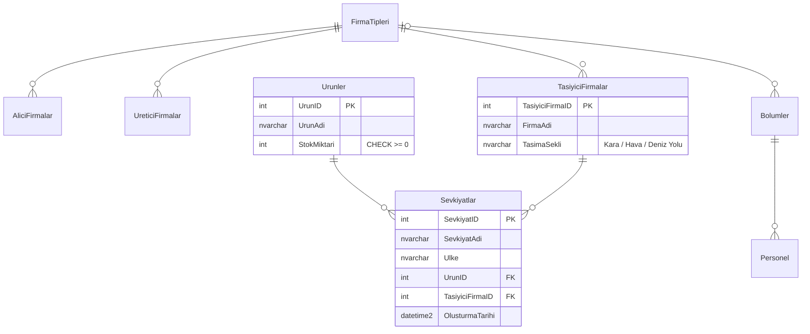

# Lojistik Otomasyonu

[](https://github.com/barisgokdemir/Lojistik-Otomasyon/actions/workflows/build.yml)


Firma, ürün, personel ve sevkiyat kayıtlarını yöneten bir **Windows Forms** masaüstü uygulaması.
İlk sürüm .NET Framework 4.5.2 ve MySQL ile yazılmış bir okul projesiydi. 2.0 sürümünde proje
**.NET 8** ve **SQL Server**'a taşındı, veri erişim katmanı da baştan yazıldı.

<!-- Ekran görüntüsü: docs/ana-ekran.png dosyasını ekleyip aşağıdaki satırın yorumunu kaldırın -->
<!--  -->

## Özellikler

- Firma tipleri, alıcı / taşıyıcı / üretici firmalar, ürünler, bölümler, personel ve sevkiyat için kayıt ekleme, listeleme, arama ve silme
- Sevkiyat, personel ve bölüm ekranlarında ID yazmak yerine açılır listeden seçim
- Listelerde ilişkili tabloların adları gösterilir (ör. sevkiyatta ürün ve taşıyıcı adı)
- Grid'de bir satıra tıklayınca silinecek kaydın ID'si otomatik dolar
- Silmeden önce onay ister; başka kayıtlarda kullanılan bir kaydı silmeye çalışınca anlaşılır uyarı verir

## Teknik notlar

| Konu | Uygulama |
|---|---|
| Veri erişimi | `Microsoft.Data.SqlClient` ile ince bir `Db` sınıfı ve tablo başına bir repository |
| Güvenlik | Tüm sorgular parametreli. Eski sürümdeki string birleştirme kaynaklı SQL injection açıkları kapatıldı |
| Arama | `LIKE` aramalarında kullanıcının yazdığı `%`, `_`, `[` karakterleri kaçışlanır |
| Bağlantı yönetimi | Her işlem `using` ile kendi bağlantısını açıp kapatır; havuzu ADO.NET yönetir |
| Hata yönetimi | `SqlException` numarasına göre kullanıcı dostu mesajlar (FK ihlali, bağlantı hatası, giriş hatası…) |
| Yapılandırma | `appsettings.json` → `appsettings.Local.json` → `LOJISTIK_` önekli ortam değişkenleri |
| Veritabanı | Yabancı anahtarlar, `CHECK` kısıtları ve FK indeksleri içeren, tekrar çalıştırılabilir şema scripti |
| CI | GitHub Actions: Windows'ta build + publish, SQL Server 2022 container'ında şema/seed testi; `v*` etiketinde otomatik release |

### Proje yapısı

```
├── database/
│   ├── 01_schema.sql          # Tablolar, kısıtlar, indeksler
│   └── 02_seed.sql            # Örnek (hayali) veriler
└── src/Lojistik/
    ├── Data/
    │   ├── Db.cs              # Bağlantı + parametre yardımcıları
    │   ├── FirmaTipi.cs
    │   └── Repositories/      # Tablo başına SQL
    ├── Forms/                 # WinForms ekranları
    ├── Ui/                    # Mesaj, hata yönetimi, doğrulama yardımcıları
    ├── AppConfig.cs
    └── Program.cs
```

### Veri modeli



## Kurulum

**Gereksinimler:** Windows, [.NET 8 SDK](https://dotnet.microsoft.com/download/dotnet/8.0), SQL Server veya SQL Server LocalDB
(Visual Studio ile birlikte gelir).

```powershell
git clone https://github.com/barisgokdemir/Lojistik-Otomasyon.git
cd Lojistik-Otomasyon

# Veritabanını oluştur ve örnek verileri yükle
sqlcmd -S "(localdb)\MSSQLLocalDB" -i database\01_schema.sql
sqlcmd -S "(localdb)\MSSQLLocalDB" -i database\02_seed.sql

# Çalıştır
dotnet run --project src\Lojistik
```

Varsayılan bağlantı LocalDB'ye gider. Farklı bir sunucu kullanmak için ya
`src/Lojistik/appsettings.Local.json` oluşturun (git'e eklenmez):

```json
{
  "ConnectionStrings": {
    "Default": "Server=.;Database=Lojistik;Trusted_Connection=True;TrustServerCertificate=True"
  }
}
```

ya da ortam değişkeni tanımlayın:

```powershell
$env:LOJISTIK_ConnectionStrings__Default = "Server=.;Database=Lojistik;User Id=...;Password=...;TrustServerCertificate=True"
```

Derlenmiş sürüm [Releases](https://github.com/barisgokdemir/Lojistik-Otomasyon/releases) sayfasından indirilebilir
(.NET 8 Desktop Runtime gerekir).

## Sürüm geçmişi

- **2.0** — .NET 8 + SQL Server'a geçiş, parametreli sorgular, repository katmanı, açılır listeler, hata yönetimi, CI
- **1.0** — .NET Framework 4.5.2 + MySQL ile ilk sürüm

## Lisans

[MIT](LICENSE)
